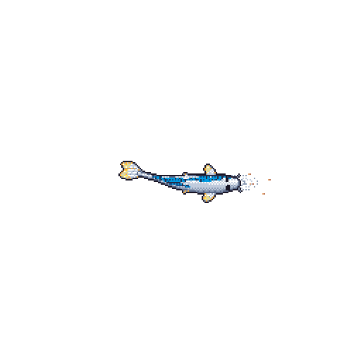
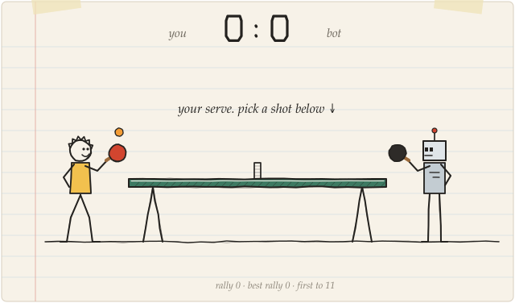

# Hey, i'm rza.

I spend time doing stuff on computers :)

Currently doing my master's in CS at TU Dresden and working on computational pathology and model interpretability at NCT Dresden.

I like Table Tennis 🏓

Based in Dresden, Germany. [Say hi](mailto:rzamirzayevedu@gmail.com).

  

### Play me at table tennis 🏓

  

<b>Take a shot.</b> Click one, then hit "Submit new issue" and refresh in a minute.

| Shot | Lands on the table | Bot returns it | Good for |
| --- | --- | --- | --- |
| [**Loop**](https://github.com/rzadevv/rzadevv/issues/new?title=pingpong:%20loop&body=Just%20submit%20this%20issue%20to%20play%20the%20shot.) | 88% | 70% | long rallies |
| [**Smash**](https://github.com/rzadevv/rzadevv/issues/new?title=pingpong:%20smash&body=Just%20submit%20this%20issue%20to%20play%20the%20shot.) | 55% | 25% | winners, if you dare |
| [**Chop**](https://github.com/rzadevv/rzadevv/issues/new?title=pingpong:%20chop&body=Just%20submit%20this%20issue%20to%20play%20the%20shot.) | 85% | 65% | annoying the bot |
| [**Lob**](https://github.com/rzadevv/rzadevv/issues/new?title=pingpong:%20lob&body=Just%20submit%20this%20issue%20to%20play%20the%20shot.) | 92% | 65% | safe points |
